<!-- Header -->

  

<!-- Typing SVG -->

  

<!-- Badges -->

  
  

 

### About

- Student at **IIT Patna**
- Building in **Full-Stack Web Dev, Data Analytics & ML Research**
- Exploring **System Design, ML Deployment & Scalable Architectures**
- ayush_24a12res897@iitp.ac.in

 

 

### Portfolio Source — Going Open Source

  <b>🗓️ 26 August 2026 — Full source drops free on GitHub.</b>

  A lot of people have been asking for the portfolio source code. 
  On <strong>26 August 2026</strong>, the complete codebase — Next.js 15, KIRO AI, 3D globe, Redis, animations — goes fully public. Free for everyone, forever. 
   
  Until then, early access is available at <a href="https://ayushcmd.me/buy"><strong>ayushcmd.me/buy</strong></a> — architecture guide, full source, or both.

  
  

 

### Projects

<table width="100%">
  <tr>
    <td width="50%" valign="top">
      <h3 align="center">CommodityChain</h3>
      

        Real-time <strong>commodity intelligence platform</strong> — live prices, AI analysis, India macro layer, Dollar Stress Index, and shock simulator. 13 modules, FastAPI backend with WebSockets.
      

      

        
        
        
        
        
      

      

        
        
      

    </td>
    <td width="50%" valign="top">
      <h3 align="center">Dollar Hegemony Dashboard</h3>
      

        End-to-end <strong>ML research system</strong> quantifying US Dollar dominance on BRICS economies. Novel Dollar Stress Index — XGBoost+SHAP, LSTM & Transformer via Ridge meta-ensemble. Live dashboard + FastAPI backend.
      

      

        
        
        
        
      

      

        
      

    </td>
  </tr>
</table>

 

### Skills

<table width="100%" align="center">
  <tr>
    <td align="center" width="25%"><b>Languages</b></td>
    <td align="center">
      
      &nbsp;
    </td>
  </tr>
  <tr>
    <td align="center"><b>Frameworks</b></td>
    <td align="center">
      
       
      
      
      
      
    </td>
  </tr>
  <tr>
    <td align="center"><b>Databases</b></td>
    <td align="center">
      
    </td>
  </tr>
  <tr>
    <td align="center"><b>Tools</b></td>
    <td align="center">
      
       
      
      
      
      
    </td>
  </tr>
</table>

 

### Stats

<table width="100%" align="center">
  <tr>
    <td width="50%" align="center">
      
    </td>
    <td width="50%" align="center">
      
    </td>
  </tr>
</table>

 

### Pac-Man Contribution Graph

  

 

### Contact

  
  
  
  
  
  

 

<!-- Footer -->

  

  <i>"Experiences over things. Knowledge over noise. Contribution over consumption."</i>

