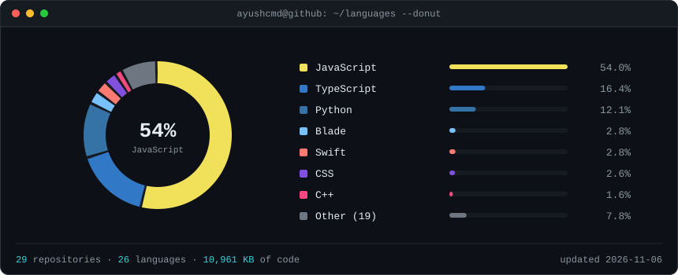
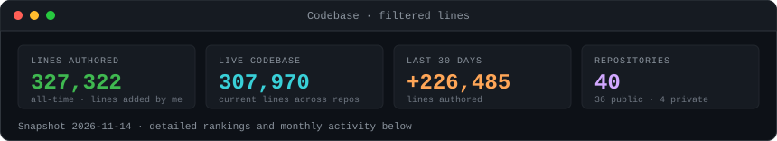
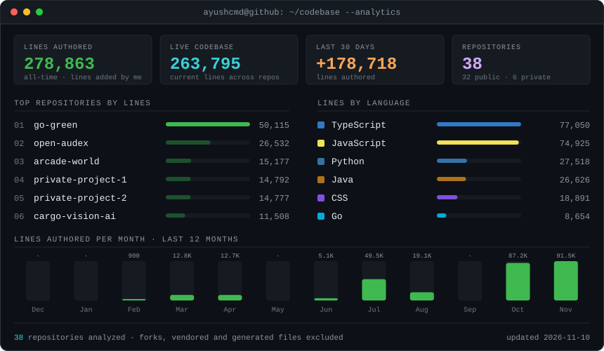
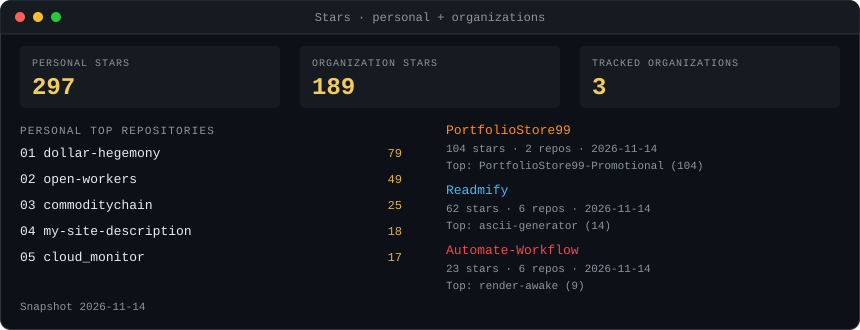
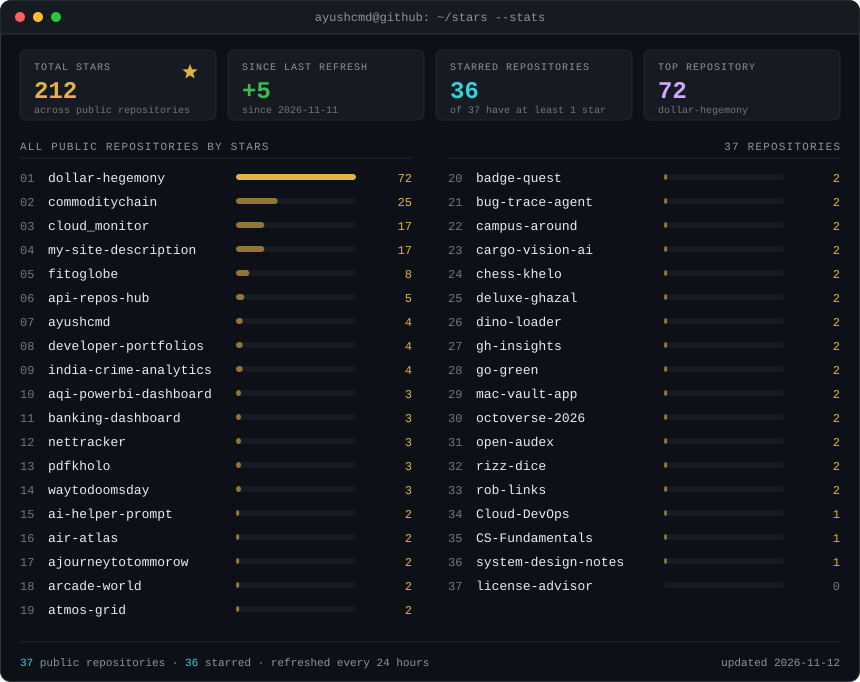
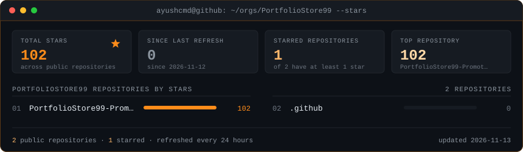
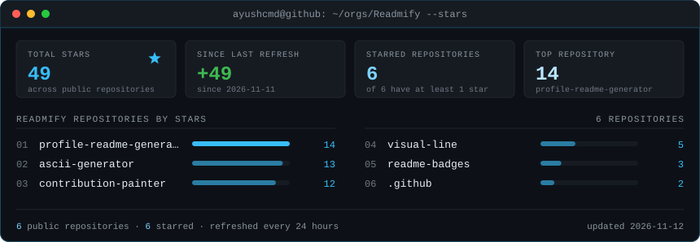
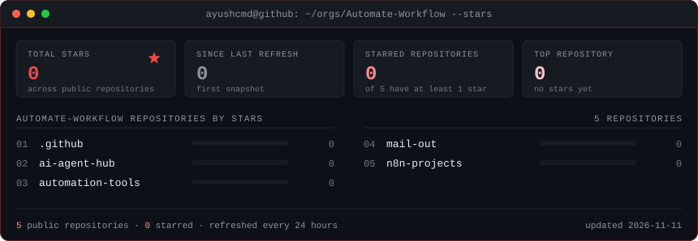

### `ayushcmd@github ~ $ whoami`

<table><tr>
<td valign="top"></td>
<td valign="top"></td>
</tr></table>

### `ayushcmd@github ~ $ cat about-me.md`

I'm **Ayush Raj**, studying **B.S. Computer Science & Data Analytics (2024–2028)** at **IIT Patna**. I build across full-stack development, Cloud & AWS, and AI/ML with Python.

[Portfolio](https://ayushcmd.me) · [GitHub](https://github.com/ayushcmd) · [LinkedIn](https://www.linkedin.com/in/ayush08iitp)

View complete technical stack

<strong>Languages &amp; Web:</strong>

  
  
  
  
  
  
  

<strong>Frontend &amp; Backend:</strong>

  
  
  
  

<strong>AI &amp; Data Analytics:</strong>

  
  
  
  
  
  
  
  
  

<strong>Cloud &amp; AWS:</strong>

  
  
  
  
  
  
  

<strong>DevOps &amp; Monitoring:</strong>

  
  
  
  
  
  
  
  
  
  

<strong>Databases &amp; Tools:</strong>

  
  
  
  
  
  

### `ayushcmd@github ~ $ ls featured-projects/`

<b>CommodityChain</b> &nbsp;•&nbsp; Real-time commodity intelligence platform

Live prices, AI analysis, India markets, correlation and simulator tools.

**Stack:** Next.js • FastAPI • TypeScript • WebSocket

**Repository:** [ayushcmd/commoditychain](https://github.com/ayushcmd/commoditychain)

<b>CargoVision AI</b> &nbsp;•&nbsp; Railway wagon inspection with computer vision

Local-first inspection using YOLOv8, OCR, defect detection and automated PDF reports.

**Stack:** PyTorch • YOLOv8 • FastAPI • React

**Repository:** [ayushcmd/CargoVision-AI](https://github.com/ayushcmd/CargoVision-AI)

<b>Dollar Hegemony</b> &nbsp;•&nbsp; USD dominance research across BRICS vs G7

ML research system with a Dollar Stress Index and an XGBoost + LSTM + Transformer ensemble.

**Stack:** XGBoost • LSTM • FastAPI • Plotly Dash

**Repository:** [ayushcmd/dollar-hegemony](https://github.com/ayushcmd/dollar-hegemony)

### `ayushcmd@github ~ $ ./analytics --overview`

Language shares use GitHub language **bytes** in public non-fork repositories. Codebase metrics count filtered **lines**; authored lines are additions attributed to me, while live lines describe the current codebase, including accessible private repositories with masked names.

View repository rankings, lines by language and monthly activity

### `ayushcmd@github ~ $ ./stars --all`

View all personal and organization repository stars

### `ayushcmd@github ~ $ ./support.sh`

